# Watch screenshots for #358

From the iOS and watchOS CI build (run 40574553878), on the smallest (40 mm) and largest (49 mm) watch simulators. They are taken a few seconds after launch, so a scrolling title can be caught mid-scroll.

## Larger text off (original look)

| Page | 40 mm | 49 mm |
| --- | --- | --- |
| `fasting` | 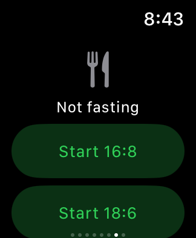 | 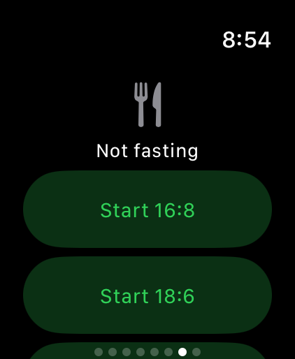 |
| `fasting-running` | 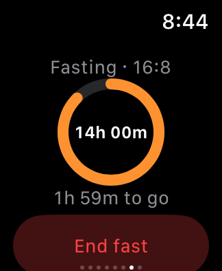 |  |
| `goals` | 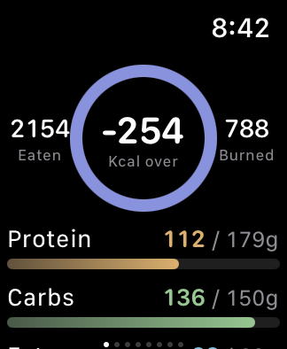 | 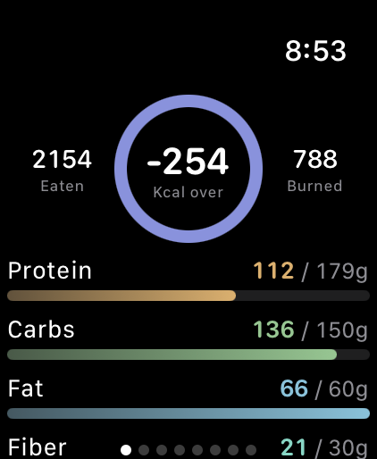 |
| `medications` | 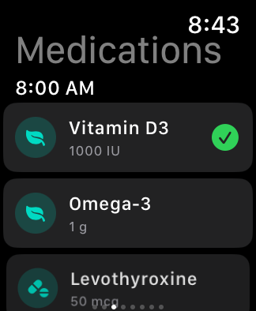 | 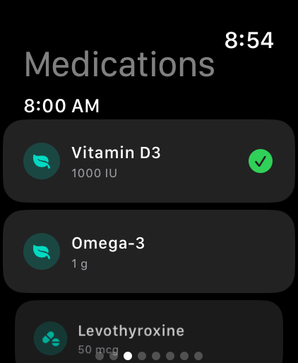 |
| `medications-dose` | 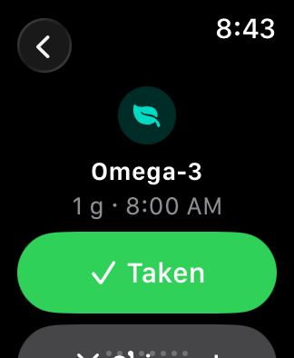 | 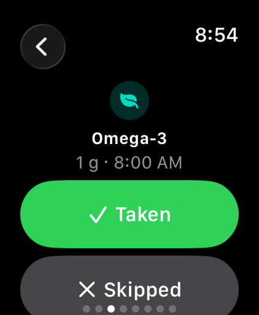 |
| `water` | 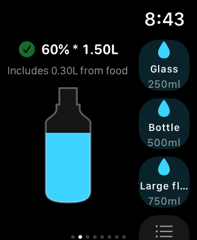 | 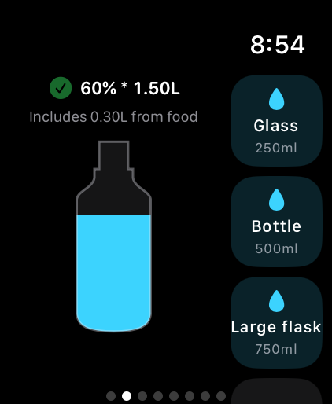 |
| `workout-actions` | 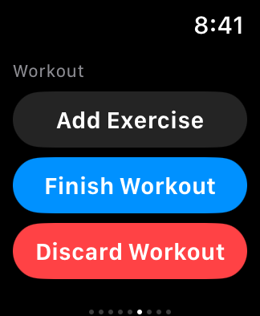 | 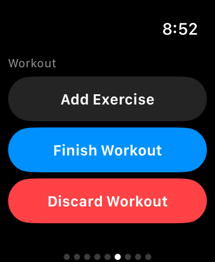 |
| `workout-active` |  | 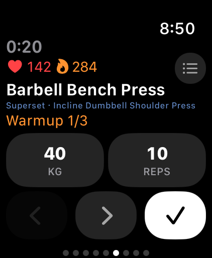 |
| `workout-exercise-options` | 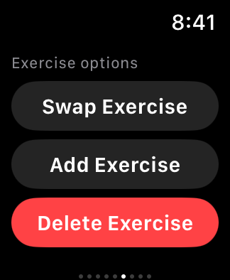 | 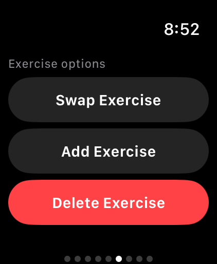 |
| `workout-exercises` | 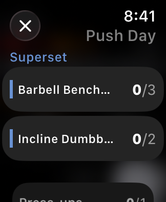 | 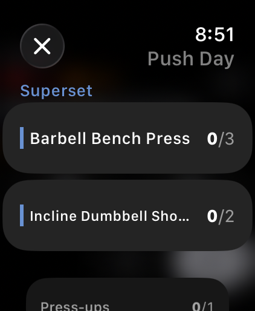 |
| `workout-idle` | 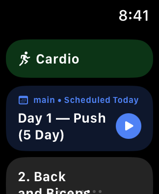 | 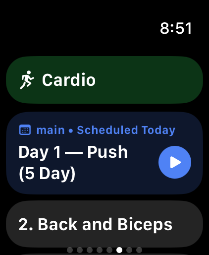 |
| `workout-interval` | 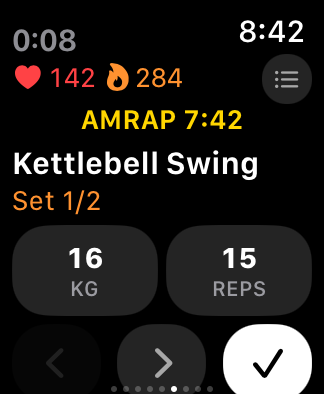 | 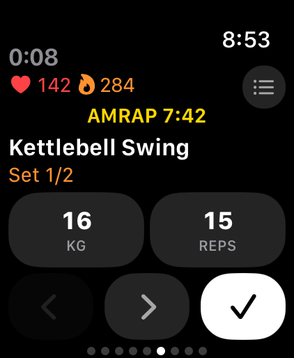 |
| `workout-longname` | 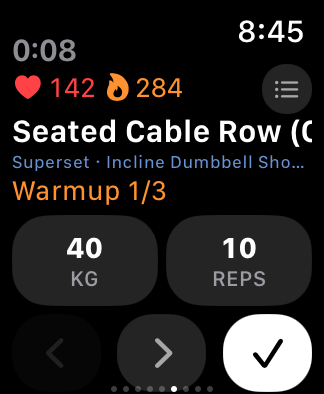 | 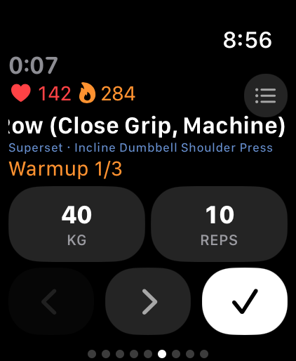 |
| `workout-metrics` | 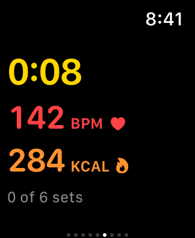 |  |
| `workout-no-metrics` | 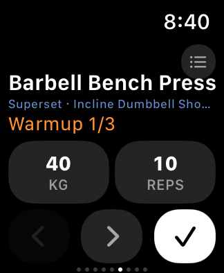 | 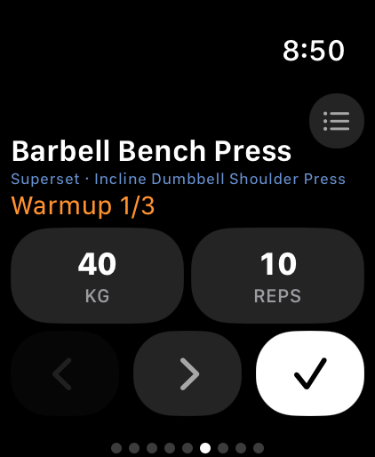 |
| `workout-resting` | 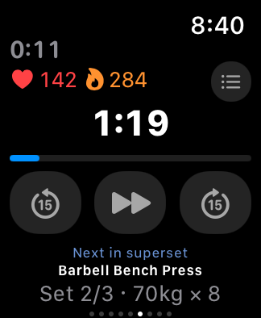 | 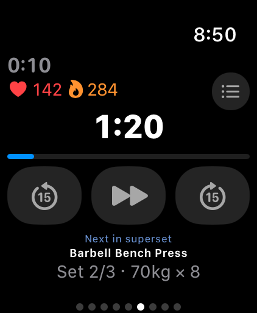 |
| `workout-rpe` | 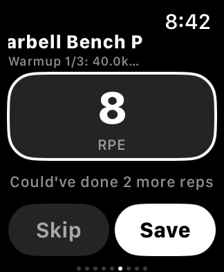 | 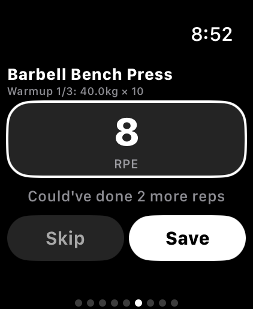 |
| `workout-rpe-longname` |  |  |
| `workout-set-options` | 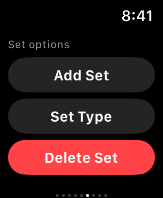 | 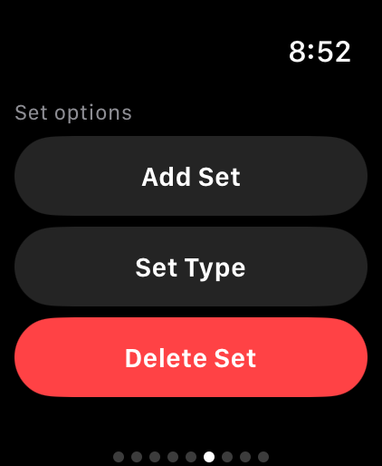 |
| `workout-stopwatch` | 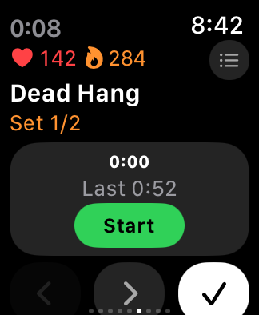 | 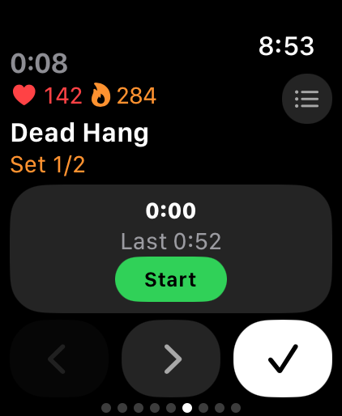 |
| `workout-swap` | 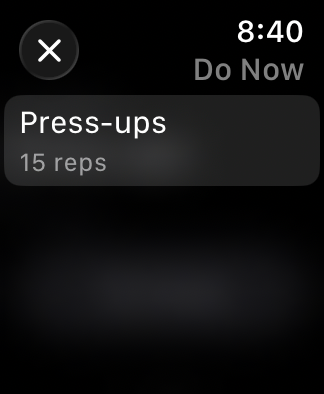 | 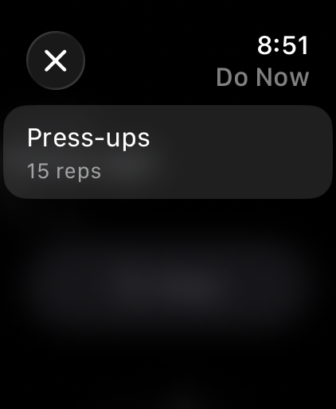 |
| `workout-timed` | 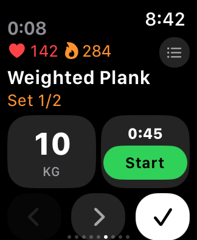 | 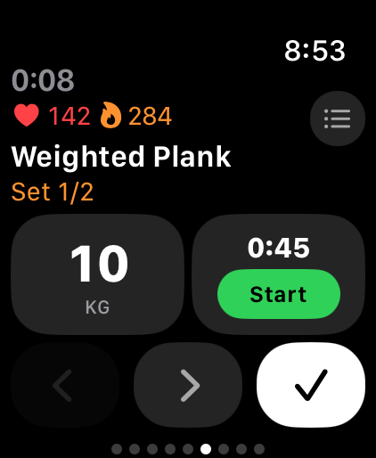 |
| `workout-update-alert` | 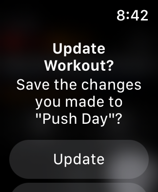 | 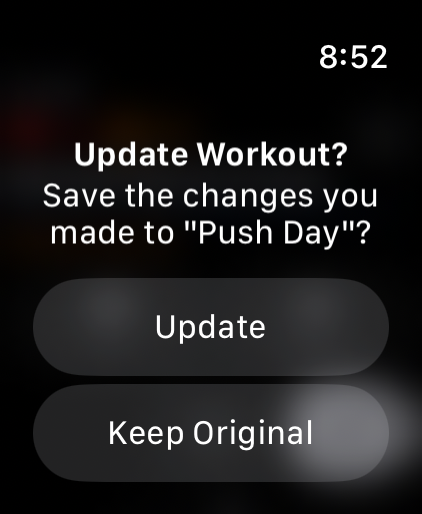 |
| `workout-upnext` | 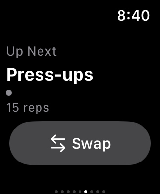 | 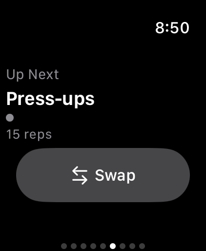 |

## Larger text on

| Page | 40 mm | 49 mm |
| --- | --- | --- |
| `fasting-running-large` |  | 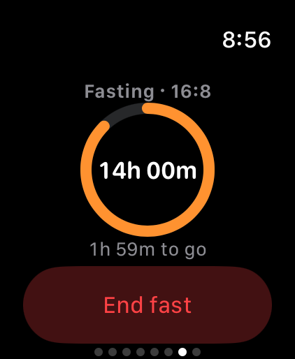 |
| `goals-large` | 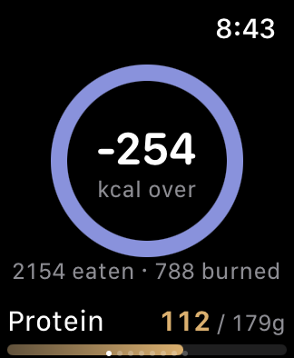 | 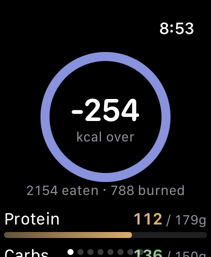 |
| `medications-dose-large` | 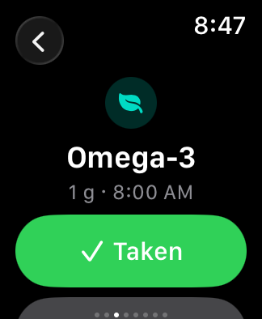 | 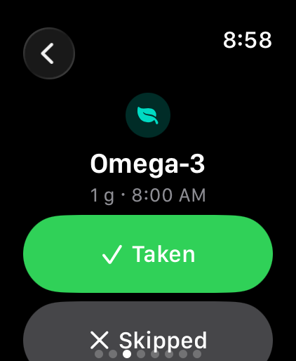 |
| `medications-large` | 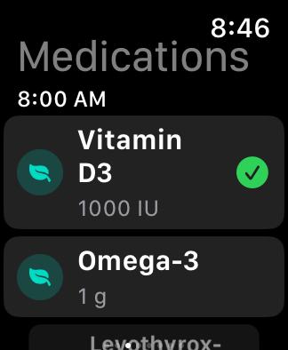 | 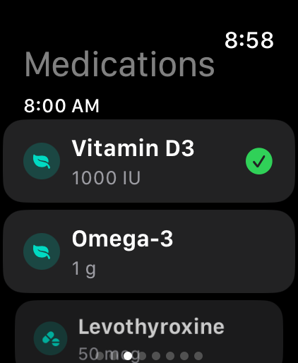 |
| `water-large` |  |  |
| `workout-active-large` |  |  |
| `workout-active-large-classic` |  |  |
| `workout-exercise-options-large` |  |  |
| `workout-idle-large` |  |  |
| `workout-longname-large` |  |  |
| `workout-longname-large-classic` |  |  |
| `workout-longname-large-later` |  |  |
| `workout-longname-large-later2` |  |  |
| `workout-metrics-large` |  |  |
| `workout-resting-large` |  |  |
| `workout-resting-longname-large` |  |  |
| `workout-rpe-large` |  |  |
| `workout-rpe-longname-large` |  |  |
| `workout-rpe-longname-large-classic` |  |  |
| `workout-upnext-large` |  |  |
